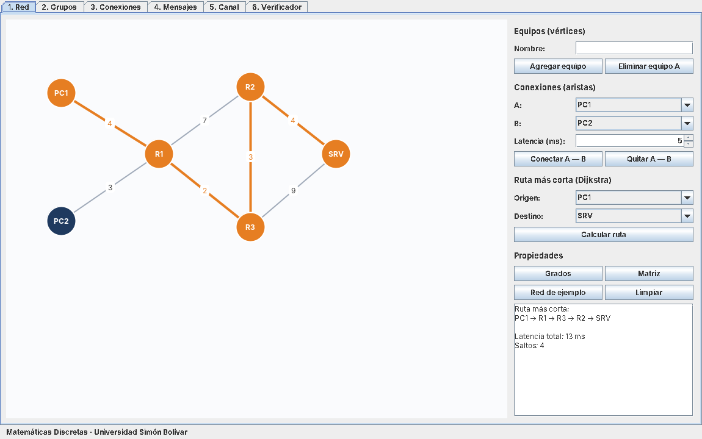
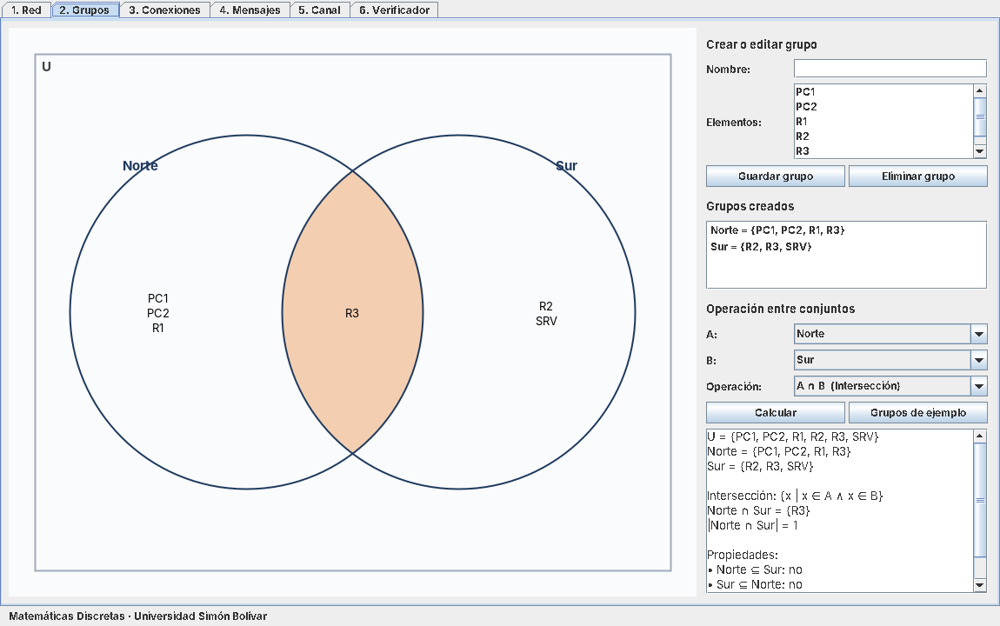
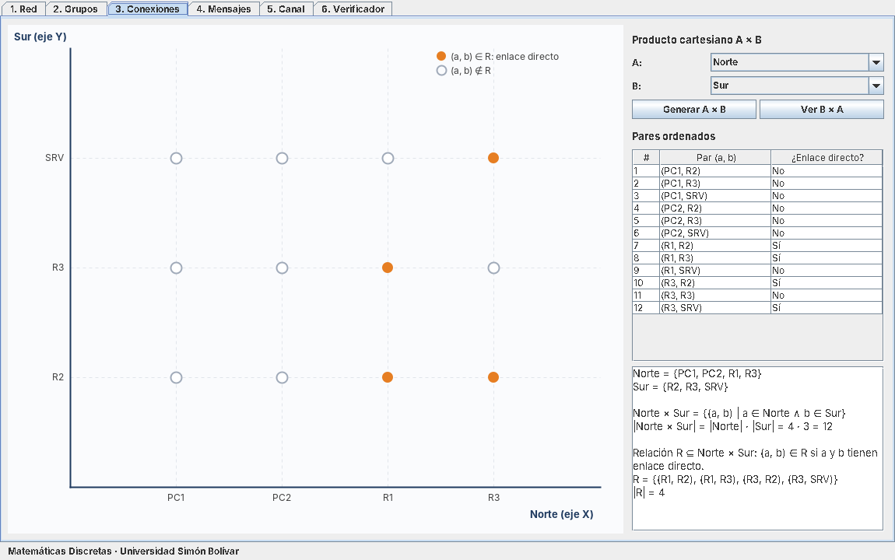
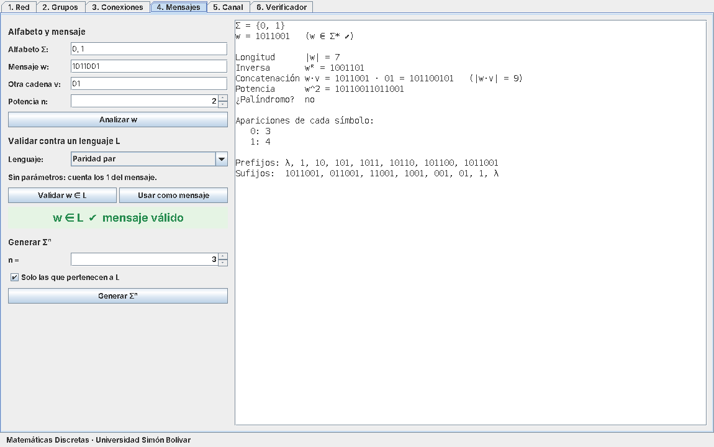
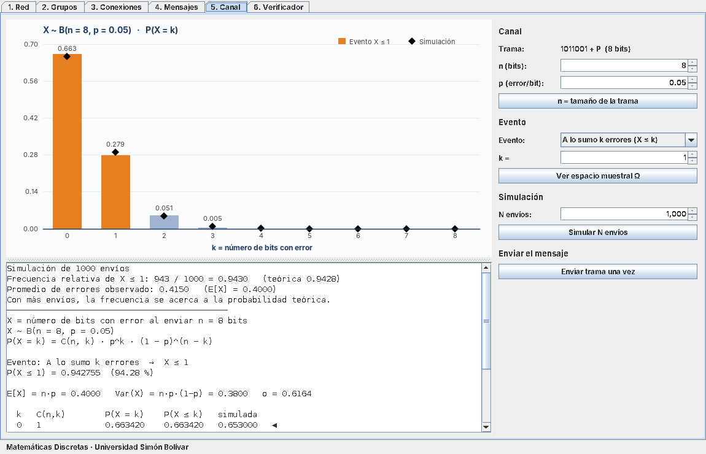
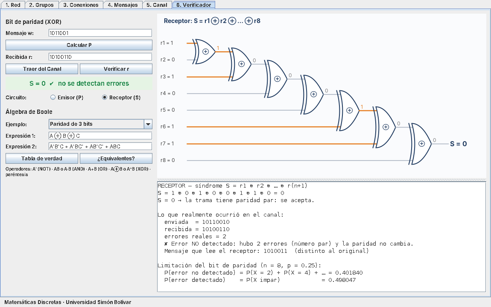

# NetDiscreta

Simulador de envío de mensajes en una red de computadores, desarrollado en **Java (Swing / JFrame)** con **NetBeans** para la asignatura **Matemáticas Discretas** – Ingeniería de Sistemas, Universidad Simón Bolívar.

El usuario construye una red, la organiza en grupos, escribe un mensaje binario, lo envía por la ruta más corta, calcula la probabilidad de error del canal y verifica si el mensaje llegó bien. En el proceso se usan todos los temas del curso.



## Módulos

| # | Módulo | Tema | Estado |
|---|---|---|---|
| 1 | Red | Grafos: vértices, aristas, grados, matriz de adyacencia, conexidad, Dijkstra | ✅ Listo |
| 2 | Grupos | Conjuntos: unión, intersección, diferencias, complemento, subconjuntos, diagrama de Venn | ✅ Listo |
| 3 | Conexiones | Producto cartesiano A × B en el plano y relación R ⊆ A × B | ✅ Listo |
| 4 | Mensajes | Alfabetos, cadenas (longitud, inversa, concatenación, potencia, prefijos, sufijos), Σⁿ y lenguajes | ✅ Listo |
| 5 | Canal | Espacio muestral Ω = {C, E}ⁿ, eventos, variable aleatoria X ~ B(n, p), media, varianza y simulación | ✅ Listo |
| 6 | Verificador | Álgebra booleana: bit de paridad con XOR, circuito de compuertas, tablas de verdad, minitérminos y equivalencias | ✅ Listo |

## Capturas

| Grupos (conjuntos) | Conexiones (A × B) |
|---|---|
|  |  |

| Mensajes (cadenas y lenguajes) | Canal (binomial) |
|---|---|
|  |  |

| Verificador (álgebra booleana) |
|---|
|  |

## Demostración completa

1. **Red:** *Red de ejemplo* → *Calcular ruta* de PC1 a SRV (13 ms).
2. **Grupos:** *Grupos de ejemplo* → prueba unión e intersección de Norte y Sur.
3. **Conexiones:** *Generar A × B* → 12 pares, 4 de ellos con enlace directo.
4. **Mensajes:** valida `1011001` contra *Paridad par* → *Usar como mensaje*.
5. **Canal:** sube p a 0.25 → *Simular N envíos* y compara la teoría con la simulación → *Enviar trama una vez*.
6. **Verificador:** *Traer del Canal* → el receptor calcula S y dice si detectó el error (y si de verdad lo hubo).

## Documentación

| Documento | Contenido |
|---|---|
| [Manual de usuario](docs/Manual_de_Usuario_NetDiscreta.pdf) | Instalación, uso de cada módulo, recorrido de demostración y solución de problemas |
| [Informe final](docs/Informe_Final_NetDiscreta.pdf) | Marco teórico, diseño, implementación, 18 casos de prueba, resultados y conclusiones |
| [Propuesta](docs/Propuesta_NetDiscreta.pdf) | Propuesta inicial del proyecto |

## Cómo ejecutarlo

**En NetBeans:**
1. *File → Open Project* y selecciona la carpeta `NetDiscreta` (NetBeans la reconoce como proyecto Maven).
2. Clic en **Run** (F6).

**Por consola** (requiere JDK 17+ y Maven):
```bash
mvn package
java -jar target/NetDiscreta-1.0.jar
```

## Estructura

```
src/main/java/
├── main/            → NetDiscreta (punto de entrada)
├── modelo/          → Nodo, Arista, Grafo, Conjunto, Estado
├── logica/          → Dijkstra, OperacionesConjuntos, ProductoCartesiano, Cadenas, Lenguaje,
│                      Binomial, Evento, EspacioMuestral, SimuladorCanal, Paridad, ExpresionBooleana
└── vista/           → VentanaPrincipal, PanelRed, PanelGrupos, PanelConexiones, PanelMensajes,
    │                  PanelCanal, PanelVerificador
    └── graficos/    → LienzoGrafo, LienzoVenn, LienzoPlano, LienzoBarras, LienzoCircuito
docs/                → Propuesta del proyecto e imágenes
```

La lógica matemática (`modelo`, `logica`) está separada de la interfaz (`vista`). Todas las pestañas comparten un mismo `Estado` (red, grupos y mensaje) y se actualizan al entrar a ellas.

## Autor

**Neyder Javier Rojas Lasso** – [GitHub](https://github.com/NeyderJavier) · [LinkedIn](https://www.linkedin.com/in/neyder-javier-rojas-lasso-952a36196)
